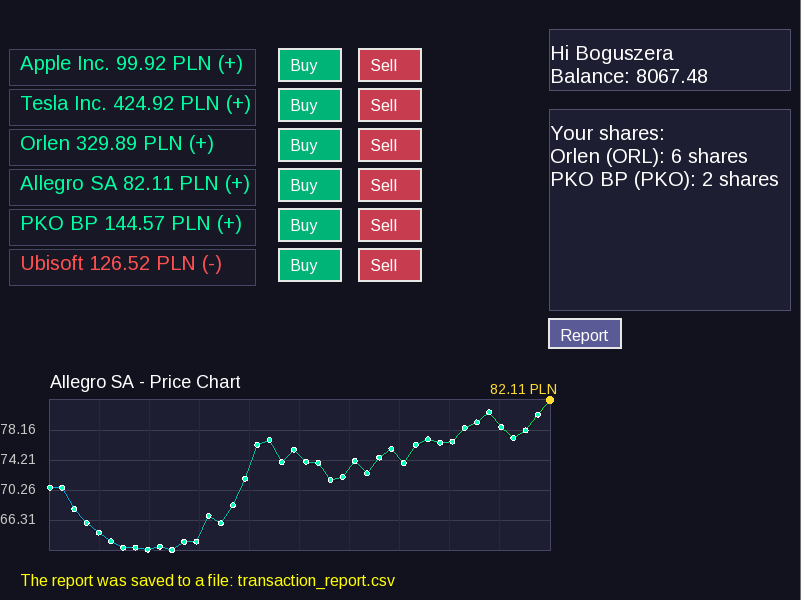

# ImVestor

## Project Description
ImVestor is an interactive desktop application written in C++ using the SFML 3.0 library that simulates a stock market.
The user can buy and sell shares of various companies, track price changes in real time using visual charts, and generate a detailed report of their transactions.

## Features:
- **Stock Market Simulation** - dynamically changing stock prices
- **Transaction System** - ability to buy and sell shares
- **Investment Portfolio** - track your owned assets
- **Interactive GUI** - user-friendly interface
- **Data Visualization** - real-time stock price charts
- **Report Generation** - create a .csv report containing transaction history and profit/loss
-----------------------------------------------------------
## System Requirements
- C++ compiler supporting the C++20 standard (e.g., GCC 10+, Clang 12+, MSVC 2019+)
- CMake version 3.20 or newer
- SFML 3.0.0 (NOTE: additional dependencies may be required on Linux systems)
- Operating system: Windows / Linux / macOS

**NOTE:** On Linux systems, you may need to install additional dependencies to compile or run the project correctly. For example:
```bash
sudo apt-get update # SFML 3.0.0 is relatively new (it may not be present in older package caches)
sudo apt-get install libx11-dev libxrandr-dev libxi-dev libxext-dev libxcursor-dev libsfml-dev
```

-----------------------------------------------------------
## Project Structure
```
ImVestor/
├── src/                    # All source files (.h and .cpp)
│   ├── Company.h           # Represents a company in the market, manages stock prices, trends, and history
│   ├── Company.cpp
│   ├── Portfolio.h         # Manages the user’s portfolio — stores and updates owned stocks
│   ├── Portfolio.cpp
│   ├── ReportGenerator.h   # Generates transaction reports
│   ├── ReportGenerator.cpp 
│   ├── SystemMessage.h     # Handles system messages within the app
│   ├── SystemMessage.cpp 
│   ├── StockHolding.h      # Represents a single stock position in the user’s portfolio (e.g., 100 shares of a company)
│   ├── StockHolding.cpp
│   ├── TransactionManager.h # Handles buying/selling logic and updates portfolio and balance
│   ├── TransactionManager.cpp
│   ├── User.h              # Stores user data: name, balance, and investment portfolio
│   ├── User.cpp
│   └── main.cpp            # Application entry point
│
├── gui/                    # Graphical User Interface
│   ├── Button.h            # GUI button class declaration
│   └── Button.cpp          # GUI button class implementation
│
├── assets/                 # Resources (fonts, images, icons, etc.)
│   └── LiberationSans-Regular.ttf  # Font used by the application
│
├── README.md               
├── .gitignore              
```

-----------------------------------------------------------
## Building the Project
```bash
 1. Clone the repository:
   git clone https://github.com/Boguszera/ImVestor.git

 2. Navigate to the project folder:
   cd ImVestor
 
 3. Create a build directory and enter it:
   mkdir build && cd build

 4. Configure the project using CMake:
   cmake ..

 5. Build the project:
   cmake --build .

 6. Run the application:
   ./ImVestor      (Linux/macOS)
   ImVestor.exe    (Windows)

```

-----------------------------------------------------------
## Usage
- After launching the application, a list of available companies with current stock prices will be displayed.

- Use the "Buy" and "Sell" buttons to perform transactions.

- Click a company name to view its price chart.

- Track your portfolio and balance in the right-hand panel.

- Use the "Report" button to generate a transaction report.
-----------------------------------------------------------

## Stock Price Change Mechanism
Stock prices are generated based on a combination of trend (upward / downward / neutral) and random fluctuations, mimicking real market behavior.

- **Trend Initialization:** Each company receives a random trend bias in the range [-2.0, 2.0], affecting the general direction of price movement.
- **Price Update:** The price changes based on the current trend and Gaussian (normally distributed) random noise, making movements less predictable.
- **Minimum Price:** Stock prices never drop below 1.0 — this prevents invalid values.
- **Trend Adjustment:** At random intervals (5–30 seconds), the trend is slightly modified by a small drift within the range [-3.0, 3.0], simulating shifting investor sentiment and reactions to events.

-----------------------------------------------------------

## License
This project uses the SFML library, available under the zlib/png license (https://www.sfml-dev.org/license.php).

The LiberationSans-Regular font is used under the SIL Open Font License (https://scripts.sil.org/OFL).

The project’s source code is released under the MIT License — see the LICENSE file for details.
-----------------------------------------------------------